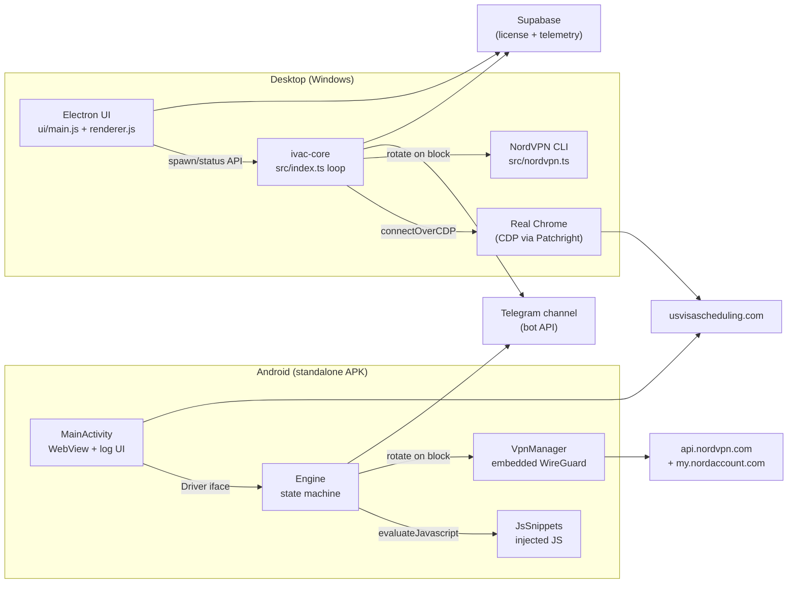
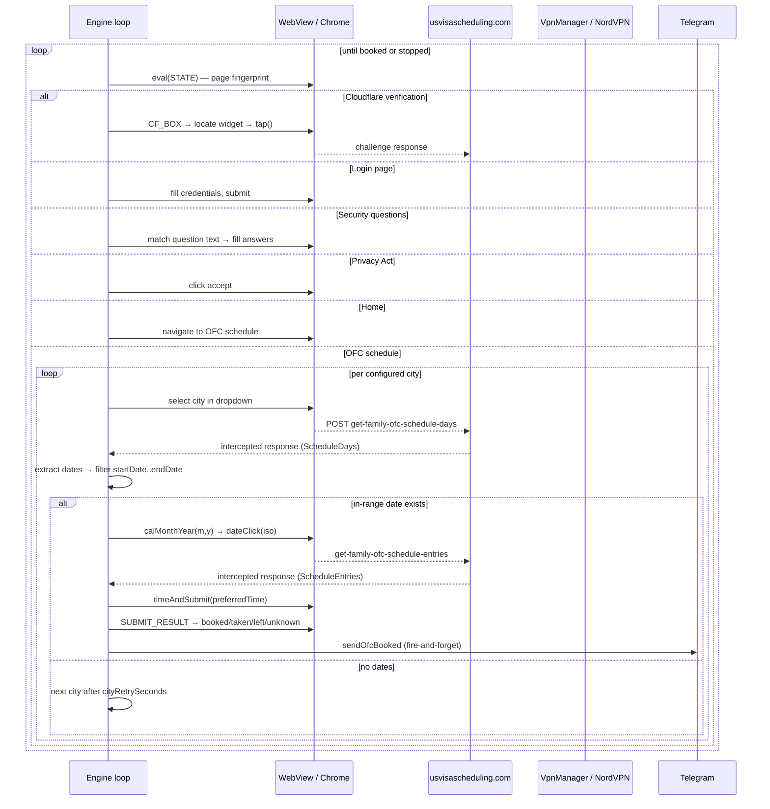
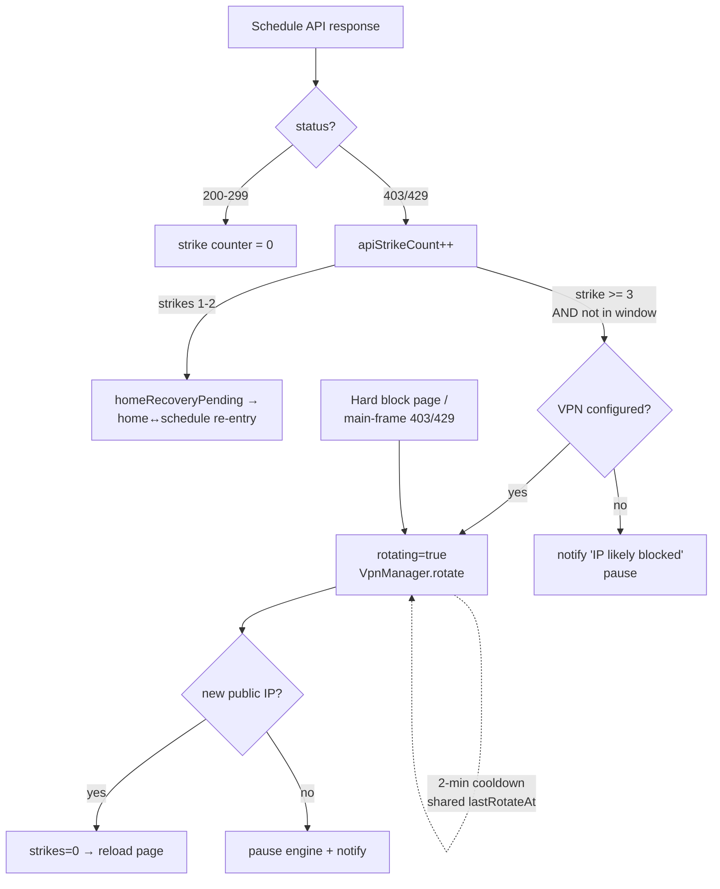
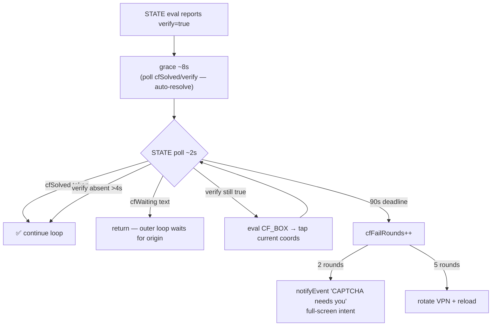
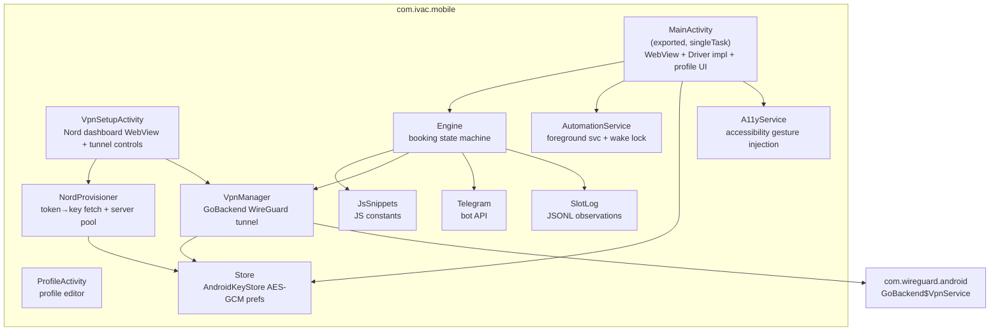

# System Architecture — IVAC

Two independent automation clients target `usvisascheduling.com` (OFC appointment booking):

| Client | Runtime | Location | Status |
|---|---|---|---|
| **Desktop launcher** | Electron UI + Node core (TypeScript, Patchright/CDP) driving a real Chrome | `src/`, `ui/` | Production |
| **Android app** | Kotlin app with an embedded WebView + in-app automation engine | `mobile_session/app/` | Active development |

Both share the same booking semantics: Cloudflare handling → login → security questions → Privacy Act → home → OFC schedule → city rotation → date/time selection → submit → Telegram notification. Mobile is a deliberate port of the desktop state machine.

---

## System context

---

## Booking pipeline (both clients)

### Key semantic: API-first

`ScheduleDays` from the intercepted `get-family-ofc-schedule-days` response is the **authoritative** availability source — each entry IS an open day. The rendered DOM calendar is only a fallback when the API response never arrives. Dates are normalized to `YYYY-MM-DD` and compared lexicographically against `appointment.startDate..endDate`.

---

## Block-triggered VPN rotation

Rotation is event-driven only — there is no periodic timer. Identical semantics on both platforms.

Desktop rotation: `src/nordvpn.ts` runs `nordvpn -d` then `nordvpn -c -g <city>` walking an **ordered city sequence** (US 55 cities → UK 4 → France 4 → Denmark → Czech Republic → Papua New Guinea → Costa Rica/San Jose, wraps; per-process index, max 5 cities per rotation). Every new IP is **geo-verified via ip-api.com** — a wrong-country exit is rejected and the walk continues; final fallback is `nordvpn -c -g <country>` for the last-attempted country (never bare Quick Connect, which lands on the fastest server). Machine-wide, all profiles share the IP, guarded by a file lock + cooldown file. Android mirrors this at **country granularity**: `VpnManager.rotate` walks the WG pool in the same country order (US → UK → FR → DK → CZ → PNG → CR, then broad-pool countries) via a per-process `rotationIndex`, and advances to a different country when the exit IP is unchanged.

Block staging is identical on both platforms (`isHardBlocked`/`blockReason` classification): **Access limitation** → cache clear (cookies preserved — `clearCache()` leaves CookieManager alone) + rotate + reload; **CF-1020 "You are blocked"** → wait 30s + navigate home first, rotate only if still blocked; **CF-1015 rate-limited** → backoff, no rotation. Schedule-API 403/429: strikes 1–2 recover via a home↔schedule re-entry (`homeRecoveryPending`), strike 3 rotates — suppressed inside special windows. A navigation timeout during recovery waits — never counted as a block.

---

## Cloudflare / Turnstile handling

**Android tap path:** `Engine.solveCloudflare()` → `Driver.tap(cssX, cssY)` → `MainActivity.tap()` converts layout-viewport CSS coords → physical px (`(css − visualViewport.offset) × (dpr × vvScale)`) → `A11yService.tapAt()` dispatches a **curved `dispatchGesture` stroke** (~150ms arc + overshoot — genuine input reaching the cross-origin Turnstile iframe); falls back to synthetic `dispatchTouchEvent` when the accessibility service isn't enabled.

**Desktop tap path:** `src/cloudflare.ts` uses 4 strategies including Bezier-curve mouse movement; falls back to waiting for a human.

---

## Android component map

| File | Role |
|---|---|
| `MainActivity.kt` | WebView host, `Driver` implementation, profile list UI, engine lifecycle, auto-resume after recreation, `profiles_import.json` bootstrap, header controls (API/REFRESH/FULL/SCRN/SET/VPN/STOP), JS-dialog auto-dismiss, service-action receiver |
| `Engine.kt` | `runLoop()` state machine + `ofcLoop()` city rotation (OFC + consular stages); staged `recoverFromBlock`, 3-strike API rotation w/ home re-entry, queue/login-fail states, checkpoint writes, direct-API sweep |
| `JsSnippets.kt` | All injected JS: `INIT` (fetch/XHR interception), `STATE` (page fingerprint + `blockReason`/`queue`/`cfSolved`/`loginFailed`), `PRIVACY`, `NAV_SCHEDULE`, `CAL_READ`, `PRE_SUBMIT`, `SUBMIT_RESULT`, `CF_BOX`, `DIRECT_*` + builders `login/secq/city/calMonthYear/dateClick/timeAndSubmit` |
| `Models.kt` | `Profile`/`Appointment`/`SecurityQ` (mirrors `config.local.json`, + `preferLeastSlots`), `PageState`/`PageInfo` fingerprint |
| `VpnManager.kt` | WireGuard `Config` build, tunnel up/down, public-IP verify, `rotate()` — 2-min cooldown + ordered `rotationIndex` walk over country-sorted pool |
| `NordProvisioner.kt` | Nord dashboard JS (token generation, page scrape), `api.nordvpn.com` credentials fetch (Basic `token:<TOKEN>`), `TARGET_COUNTRIES`-ordered WG server pool fetch+parse+cache |
| `VpnSetupActivity.kt` | Nord login WebView, GET KEY / SERVERS / CONNECT / ROTATE / DISC / PASTE / SCRAPE controls |
| `ProfileActivity.kt` | Minimal editor: credentials, 3× security-Q dropdowns (Electron question groups) + answers, VAC city checkboxes, dates, preferred time, retry seconds, dry run, prefer-least-busy |
| `Store.kt` | AES-256-GCM in AndroidKeyStore; `profiles_v2` + `set_*` keys; `importDesktopConfig` merge preserving `dryRun`/`enabled`/`cityRetrySeconds` |
| `AutomationService.kt` | `dataSync` foreground service, persistent notification w/ live status + Pause/Resume/Stop actions, 12h partial wake lock |
| `A11yService.kt` | Curved-stroke `dispatchGesture` taps at absolute screen coords (for cross-origin iframes) |
| `Checkpoint.kt` | `checkpoint.json` in `filesDir`, last state/city/URL per loop tick (port of `src/checkpoint.ts`) |
| `SlotLog.kt` | `slot-observations.jsonl` in `filesDir`, one JSON per calendar-visibility event |
| `Telegram.kt` | Success-only: `sendOfcBooked`/`sendConsularStage`/`sendConsularBooked`, hardcoded defaults overridable via SET dialog |

## Desktop component map

See `ARCHITECTURE.md` (root) and `docs/desktop.md` for the full `src/*.ts` module table. In short: `ui/main.js` (Electron main) spawns `src/index.ts` via `tsx` in dev (or `ivac-core.exe` packaged), which runs the same detect→act loop against a real Chrome over CDP, with `api-direct.ts` providing the 3-tier fast submission path the mobile port does not yet have.
