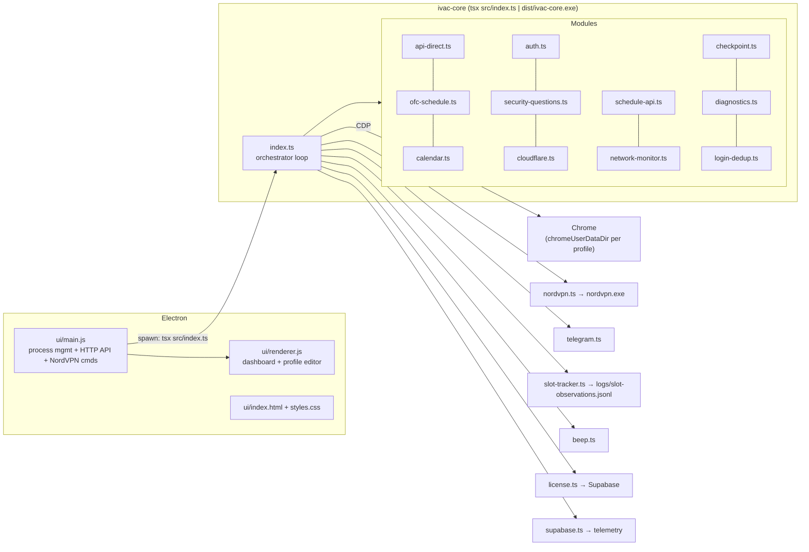
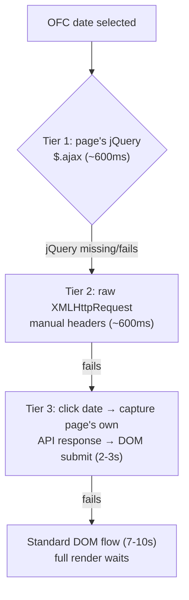

# Desktop Launcher — Module Reference

The desktop app automates OFC (and consular) booking on `usvisascheduling.com` from Windows. An Electron UI (`ui/`) spawns and supervises a Node core (`src/`), which drives a real Chrome browser through Patchright (stealth Playwright fork) over CDP.



## `src/` modules

| File | Responsibility |
|---|---|
| `index.ts` | Main orchestrator — infinite loop, page-state machine (`resumeFromCurrentPage`), health checks, error recovery, `recoverFromBlockPage` (staged hard-block recovery), city rotation, special-window timing (`:MM:58` triggers), checkpoints, direct API integration |
| `api-direct.ts` | 3-tier fast OFC submission (details below) |
| `ofc-schedule.ts` | `navigateToOfcSchedule` (with `isHardBlocked` checks after home nav + schedule-link click), city dropdown selection with DOM event dispatch, time-slot selection (preferred or highest-availability), submission |
| `consular-schedule.ts` | Consular stage scheduling (entered after OFC success) |
| `calendar.ts` | Calendar readiness, month/year `<select>` manipulation, date extraction from `td[data-month][data-year]`, date click with in-page dispatch fallback |
| `schedule-api.ts` | Intercepts `get-family-ofc-schedule-days` responses; JSON extraction with malformed-JSON fallback |
| `auth.ts` | Login form detection, human-like credential entry, submit retry (≤3), error detection |
| `security-questions.ts` | Fuzzy question matching, answer field location, form submit |
| `cloudflare.ts` | Turnstile/CAPTCHA detection (12 selectors + body regex), `isHardBlocked` (Access limitation / CF-1020 blocked / CF-1015 rate-limit classification), 4-strategy auto-solve with Bezier mouse movement, manual-wait fallback |
| `login-dedup.ts` | Prevents duplicate concurrent logins across tabs/resume paths |
| `network-monitor.ts` | XHR/fetch logging — always logs 403/429/5xx, verbose with `debugNetwork` |
| `checkpoint.ts` | Crash-recovery state in `artifacts/state/checkpoint.json` |
| `diagnostics.ts` | Screenshots → `artifacts/screenshots/`, page dumps → `artifacts/logs/`, traces → `artifacts/traces/` |
| `browser.ts` | Chrome launch/CDP connect/port probing/tab selection; `eval('require')` for pkg compatibility |
| `config.ts` | `config.local.json` + env loading, strict validation, `AutomationConfig`/`AppointmentConfig`/`SecurityQuestionConfig` types |
| `license.ts` | Supabase-backed license validation, `.license` file read/store/clear, `HOSTNAME\Username` system binding |
| `nordvpn.ts` | Machine-wide NordVPN CLI rotation (`-d` then `-c -g <city>`), ordered 67-target city sequence (US 55 → UK → FR → DK → CZ → PNG → CR San Jose, wraps; per-process index), IP verify via ipify + **geo check via ip-api.com** (wrong-country exits rejected), `-g <country>` fallback, file lock + 2-min cooldown files, `getCurrentPublicIP` |
| `telegram.ts` | Fire-and-forget OFC-booked HTML message to a hardcoded channel |
| `slot-tracker.ts` | Appends calendar-visibility observations to `logs/slot-observations.jsonl` (fire-and-forget, never throws) |
| `beep.ts` | Dual-beep alert on calendar visibility (Windows, detached PowerShell) |
| `supabase.ts` | Optional fire-and-forget telemetry events |
| `logger.ts` | Structured `[INFO]/[WARN]/[ERROR]/[DEBUG]` console logging |
| `utils.ts` | `pageHasSelector`, `isLoginPage`, `waitForPortOpen`, `normalizeText` |

## Direct API — 3-tier submission

The fast path the mobile port lacks. Injects into the page's own context:



Tier 1/2 reuse the page's configured headers and anti-CSRF tokens; Tier 3 adds zero extra API requests.

## `ui/` (Electron launcher)

| File | Responsibility |
|---|---|
| `main.js` | Electron main — spawns `ivac-core` per profile (`tsx` in dev, `ivac-core.exe` packaged), HTTP API for the dashboard (`/api/profiles`, `/api/start`, `/api/stop`, `/api/logs`, `/api/slot-observations`, `/api/rotate-ip`, `/api/current-ip`), NordVPN CLI manual rotation, stop-signal files |
| `renderer.js` | Dashboard logic, profile editor modal (incl. the 3×5 security-question dropdown groups the mobile editor mirrors), Slot Pattern viewer |
| `index.html`, `styles.css` | Shell markup + styles |

## Multi-profile model

Each profile gets: its own Chrome (`chromeUserDataDir`, `chromeRemoteDebugPort`), its own `ivac-core` process, stop-signal file `.ivac-stop-<id>`, checkpoint, and log. **All profiles share one machine-wide NordVPN IP** — a block on one profile affects all.

## Config shape (`config.local.json`)

```jsonc
{
  "profiles": [{
    "id": "p…", "instanceIndex": 1,
    "username": "…", "password": "…",
    "securityQuestions": [{ "question": "…", "answer": "…" }],   // ×3
    "appointment": {
      "city": ["NEW DELHI VAC", "HYDERABAD VAC", "KOLKATA VAC", "CHENNAI VAC", "MUMBAI VAC"],
      "startDate": "2026-09-17", "endDate": "2026-12-31",
      "preferredTime": null
    },
    "chromeRemoteDebugPort": 9222,
    "chromeUserDataDir": "<abs path>"
  }],
  "settings": { "nordvpn": { "exePath": "…", "connectTimeoutMs": 30000 } }
}
```

## Build pipeline

`npm run protect` (esbuild bundle+minify → `protected/`) → `npm run build:core` (`@yao-pkg/pkg` → `dist/ivac-core.exe`) → `npm run build:release` (`scripts/build-release.mjs` → electron-builder `release<N>/win-unpacked/` + zip). Modes: `--mode=dev`, `--mode=client`.

**Known issues:** winCodeSign Darwin-symlink error is tolerated (no signing); `eval('require')` warning is required for pkg; UI files are never obfuscated (breaks event handlers).
