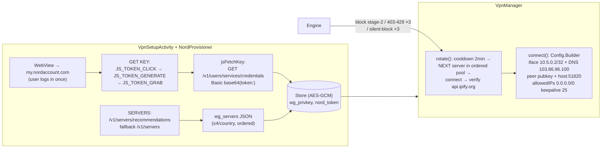

# Android App — Architecture & Internals

`mobile_session/app/` — a standalone Kotlin app that runs the same booking loop as the desktop core, inside an embedded WebView. No PC, VPS, or ADB needed at runtime. Package `com.ivac.mobile`, minSdk 24 / targetSdk 34, JDK 17, Gradle 8.9 (see `docs/operations.md` for the local toolchain layout). Product improvement notes for this app live in `mobile_session/AGENTS.md` (the Android counterpart of the root `AGENTS.md`).

## App shell

Three activities + three services, all declared in `AndroidManifest.xml`:

| Component | Exported | Purpose |
|---|---|---|
| `MainActivity` | yes (launcher, `singleTask`, all `configChanges` handled) | WebView host, `Driver` impl, profile list, log pane, engine lifecycle |
| `ProfileActivity` | no | Minimal profile editor (Electron-parity fields) |
| `VpnSetupActivity` | no | Nord dashboard WebView + WireGuard tunnel controls |
| `AutomationService` | no (`dataSync` fg service) | Keeps process alive backgrounded/screen-off; persistent status notification; 12h `PARTIAL_WAKE_LOCK` |
| `A11yService` | yes (bound by system, `BIND_ACCESSIBILITY_SERVICE`) | `dispatchGesture` genuine-input taps for the cross-origin Turnstile iframe |
| `GoBackend$VpnService` (wireguard lib) | no (`BIND_VPN_SERVICE`) | The actual `tun0` interface owner |

Permissions: `INTERNET`, `ACCESS_NETWORK_STATE`, `WAKE_LOCK`, `FOREGROUND_SERVICE`, `FOREGROUND_SERVICE_DATA_SYNC`, `POST_NOTIFICATIONS`, `USE_FULL_SCREEN_INTENT`, `REQUEST_IGNORE_BATTERY_OPTIMIZATIONS`.

## Driver abstraction

`Engine` never touches Android UI directly — it drives the page through the `Driver` interface (`Engine.kt` top), implemented by `MainActivity`:

```kotlin
interface Driver {
    suspend fun eval(js: String): String        // evaluateJavascript → unwrapped string
    suspend fun tap(cssX: Double, cssY: Double) // CSS coords → screen coords → gesture
    suspend fun reload()
    suspend fun clearCache()                    // WebView disk cache — cookies preserved (CookieManager)
    fun beep()                                  // audible alert — desktop playBeep parity
    fun log(msg: String)                        // on-screen log pane + Logcat "IVAC"
    fun client(emoji: String, msg: String)      // prominent status line in log
    fun notifyEvent(title: String, msg: String) // Android notification ONLY — never Telegram
    fun setStatus(status: String)               // status chip + fg-service notification
    fun isStopped(): Boolean
    fun lastMainFrameHttpError(): Int
}
```

Net interception does **not** flow through `Driver` — `IvacBridge.net()` calls `Engine.onNetEvent` directly.

Because the UI is the driver, the same `Engine` could run against a test double — the seam for future unit tests.

## JS bridge

- `webView.addJavascriptInterface(IvacBridge(), "IVAC")` gives injected JS two sinks: `IVAC.log(str)` → log pane, `IVAC.net(json)` → `Engine.onNetEvent`.
- `Js.INIT` is re-injected on `onPageStarted` **and** `onPageFinished`: it wraps `fetch` + `XMLHttpRequest` so every XHR response is mirrored to `IVAC.net({u,s,req,res})`.
- `Engine.onNetEvent` filters for `schedule-group` / `custom-actions` traffic, logs `[api] route → status`, pushes `get-family-ofc-schedule-days` / `…-entries` JSON into conflated `Channel`s, and counts 403/429 strikes for rotation.

## Engine state machine

`runLoop()` evaluates `Js.STATE` each cycle → `PageInfo.fromJson` → `PageInfo.state` maps DOM signals to:

```mermaid
stateDiagram-v2
    [*] --> detect
    detect --> VERIFICATION: cf widget/verify text
    detect --> QUEUE: virtual-queue text
    detect --> HARD_BLOCKED: blockReason ≠ ""
    detect --> RATE_LIMITED: CF-1015 / rate-limit text
    detect --> ERROR_PAGE: 5xx/conn-error page
    detect --> LOGIN: login form
    detect --> SECURITY_Q: secq fields
    detect --> PRIVACY: privacy act
    detect --> HOME: schedule link / Home title
    detect --> OFC: /ofc-schedule URL
    detect --> CONSULAR: /schedule URL
    detect --> UNKNOWN: else
    VERIFICATION --> detect: solver v2 (grace → revolving taps)
    QUEUE --> detect: wait 15s — NEVER reload
    HARD_BLOCKED --> detect: staged recoverFromBlock
    RATE_LIMITED --> detect: backoff 45→120s; rotate on ×3
    ERROR_PAGE --> detect: backoff reload (≤5 → pause)
    LOGIN --> detect: fill+submit (loginFailed → pause)
    SECURITY_Q --> detect: answer by question match
    PRIVACY --> detect: accept
    HOME --> detect: NAV_SCHEDULE
    OFC --> detect: ofcLoop city cycle
    CONSULAR --> detect: ofcLoop city cycle (VAC-stripped)
    UNKNOWN --> detect: wait; reload after 30 rounds
    OFC --> CONSULAR: booked → continue (not stop)
    CONSULAR --> [*]: consular booked
```



Priority order inside `PageInfo.state`: verify → queue → rateLimited → blockReason → errorPage → privacy → secQ → login → OFC/consular → home → unknown.

`STATE` classification mirrors desktop `isHardBlocked`: CF selectors (`#cf-error-details`, `#cf-wrapper`, `.cf-subheadline` containing the domain) → `cloudflare_blocked`; title/body regexes → `access_limitation` / `cloudflare_blocked` / `rate_limited`. Additional signals: `queue` (virtual-queue texts — never reloaded), `cfSolved` (`cf-turnstile-response`/`cf_challenge_response` token populated — definitive solve verdict), `loginFailed` (`ExternalAuthenticationFailed` URL or sign-in-failed text → pause instead of blind retries).

### OFC/consular loop detail (`ofcLoop()`)

1. Strike-1/2 recovery: `homeRecoveryPending` → jittered 3–5s pause → navigate home → `NAV_SCHEDULE` re-entry (desktop parity — a stale CF session resets via home↔schedule before strike 3 burns an IP).
2. `Js.city(name)` selects the VAC city — consular stage strips the ` VAC` suffix (`NEW DELHI VAC` → `NEW DELHI`, desktop `consular-schedule.ts` parity). Single-city profiles pass `withEmptyPreselect`.
3. `waitSchedDays(respWaitMs())` — API `ScheduleDays` is authoritative; DOM calendar is UNIONed in so a stale API payload can't hide visible green dates.
4. `extractApiDates()` normalizes `ScheduleDate|Date|CalendarDate|Day|SlotDate` → `YYYY-MM-DD`; `inRangeList()` filters `startDate..endDate` (lexicographic).
5. On any calendar visibility: `SlotLog.record()` (`stage="ofc"`/`"consular"`) + notification + `beep()` (dual-tone, desktop `playBeep` parity).
6. Per in-range date (ALL candidates, desktop parity): `calMonthYear` → re-read DOM cal → `dateClick` (one retry) → entries wait → `PRE_SUBMIT` → **slot loop** (`Js.pickSlot` iterates every time slot on the date — a taken/failed submit falls through to the next slot, capped at `MAX_SLOTS_PER_DATE=5`) → quick ~600ms `SUBMIT_ENABLED` check then force-enable + `fireSubmit` (desktop: `jsdata.Num` is set synchronously by the radio click, so `onClickSubmit()` works before formal enable) → `SUBMIT_RESULT` + authoritative `appointments-for-family` verdict (empty 2xx HTML wrappers skipped for the real JSON body; `AllScheduled`/`HasError`/`RedirectStub` parsed — `RedirectStub` navigates straight to `/en-US/<stub>` instead of waiting on the site redirect).
7. Disguised-block guard: when both API and calendar come back empty, the page is re-fingerprinted for `blockReason` before advancing city.
8. Outcomes: OFC `booked` → `Telegram.sendOfcBooked` + beep + `Checkpoint.save("ofc-booked")` → **returns to runLoop which continues into the consular stage**; consular `booked` → `Telegram.sendConsularBooked` + stop; `taken`/`HasError` → next time slot; `left` → outer loop resumes.
9. Next city after `computeRetryDelay` — full desktop special-window port: `:58`-of-minute triggers **12, 25, 29, 36, 49, 55, 59** on the **local system clock**, `preciseSleepUntilSpecialWindow` (~ms precision), and `beginSpecialSweep` multi-city sweep (all desired cities once each, 2-4s gaps, 60s-per-city cap, `abortSpecialSweep` on a wedged response).

After OFC success the engine waits for the site redirect to `/en-US/schedule/` (up to 2min — never re-runs the OFC cycle, avoiding double-book). The first CONSULAR detection per run fires `Telegram.sendConsularStage` once, then the same DOM cycle books consular slots.

**Consular stage (desktop `consular-schedule.ts` parity):** dedicated `profile.consular` config — `cities` (empty → OFC cities minus " VAC"), `startDate`/`endDate` (empty → **earliest available**, unbounded — the site never renders dates earlier than the booked OFC appointment), `cityRetrySeconds` (default 15). Cadence: all consular cities swept per pass with 2–4s gaps; the retry delay applies only between full sweeps. Status shows the booked OFC appointment scraped once from `window.ofcAppointments[0].appointmentDateStr` (`Consular — OFC: <date>`). Same DOM contract as OFC (`#post_select`, `#time_select`, `#submitbtn`, `jsdata.Num`); consular routes land in the same response channels, so the submit verdict stays response-aware. On consular success → `confirmationPdfFlow()` (below).

`dryRun=true` never clicks the final submit (JS still performs date/time selection).

## Cloudflare solving (solver v2)

`solveCloudflare()` — rebuilt on USAVISABOTV3 (`usavisa/turnstile.py`) findings:

1. **Auto-resolve grace (~8s)** — many challenges self-clear; no tap is attempted during the grace window. Polled every 2s via `cfSolved`/`verify`.
2. **Revolving tap loop (~90s)** — while the challenge is live, `Js.CF_BOX` is re-evaluated each poll and the *current* widget coords are tapped every ~1.5–2s. The widget re-renders/revolves mid-solve ("Cannot find Widget cf-chl-widget-*" console churn); per-poll re-detection survives that.
3. **Pass verdicts** — `cf-turnstile-response`/`cf_challenge_response` token populated (definitive), `cfWaiting` text (solved, origin answering — outer loop waits), or verify markers absent >4s (debounced against re-render gaps).

`Js.CF_BOX` finds the Turnstile host — `#cf-turnstile`, `iframe[src*="cloudflare.com"]`, or the sized ancestor of the hidden `cf-chl-widget-*` input — `scrollIntoView`s it, and returns its `getBoundingClientRect()`. The tap lands at `x + min(w·0.11, 36px), y + h/2` (the checkbox square).

Tap transport (`MainActivity.tap()`): CSS coords → physical px — `physical = (css − visualViewport.offset) × (viewPx / visualViewport.width)` (self-calibrating, verified on-device) — then `A11yService.tapAt()` dispatches a sub-slop `dispatchGesture` stroke (down/up on target with ±2.5px micro-wiggle, hold 80–150ms, ~15% of taps hold 180–340ms). Genuine input reaches the cross-origin iframe; falls back to synthetic `dispatchTouchEvent` when the accessibility service is unbound.

Human-signature layer (solver loop): ~75% of attempts are preceded by `A11yService.glideThrough` — a **cubic-bezier finger-glide that sweeps across the widget** (12–20 waypoints, 350–700ms, enters ~150–340px to one side, exits ~70–160px past the other, lifts off the box so it never registers as a click). The genuine `touchmove` stream inside the iframe is what Turnstile scores before a click — a tap materializing from nowhere is a bot tell. Attempt rhythm is 1.4–3.2s with a 3.5–6s "recheck" pause every ~4th (a metronome is also a tell). Every 3rd attempt additionally fires `cfKeySolve` (focus + SPACE via `dispatchKeyEvent` — a second genuine-input channel; the only path when a11y is unbound).

Escalation: 2 failed rounds → "CAPTCHA needs you" notification (deduped 5min, **full-screen intent** brings the app forward); every 4th failed round → VPN rotate + reload. `VpnManager.rotate` now prefers exits outside the burned exit's /16 — Nord egress ranges are shared across countries and CF flags the range.

**Verified on-device (Samsung A26, WebView 153):** the widget accepts `dispatchGesture` taps — `cf_clearance` is issued every round (1–4 attempts). `input tap` (shell-injected events) does NOT activate the widget — synthetic events are detectably synthetic even to Turnstile. If `cf_clearance` issues but the next nav still 403s, the origin is re-challenging at policy level (site in aggressive mode affects real Chrome on residential IPs too) — rotate and keep the loop patient; no client-side fix exists for that phase.

## VPN — embedded WireGuard (NordLynx)

Fully self-contained; no external VPN app.



**Ordered rotation** (desktop `CITY_ROTATION_SEQUENCE` parity at country granularity): the pool is fetched in `NordProvisioner.TARGET_COUNTRIES` order — **US → UK → France → Denmark → Czech Republic → Papua New Guinea → Costa Rica** first (the desktop sequence), then broad-fleet countries (Canada, Netherlands, Germany, Switzerland, Sweden, Spain, Italy, Japan, Singapore, Australia, UAE, Hong Kong) as tail depth; India is excluded (virtual-India servers share one NAT egress). `VpnManager.rotate` walks the ordered pool via a per-process `rotationIndex` that wraps — every process starts at the first US server, like the desktop's in-memory city index. Same-exit-IP retries advance to the next *different-country* entry (≤3 tries per rotation).

**Triggers** (in `Engine`, desktop `recoverFromBlockPage` + strike semantics):
- `HARD_BLOCKED` page → `recoverFromBlock(blockReason)`: `access_limitation` → `clearCache()` + rotate + reload; `cloudflare_blocked` (CF-1020) → **two-stage**: wait 30s → navigate home → re-check; only if still blocked → `clearCache()` + rotate; `rate_limited` → 60s backoff + reload, never rotates.
- Schedule-API `403/429` → **403** strikes 1–2 set `homeRecoveryPending` (home re-entry, jittered 3–5s pause); **429** strikes 1–2 set `rateLimitHoldPending` (60–90s quiet on-page hold + one reload — home navigation fires ~6-8 requests and keeps the limiter hot). **Strike 3 → rotate**, but only after a live `detectState` confirms the page isn't actually a hard-block page (defers to `recoverFromBlock` staging); suppressed inside drop windows via `suppressApiRotateUntil`. `blockCycleCount` circuit breaker: 3 full strike→rotation cycles with no clean response → 10-min cooldown + notification (block isn't IP-scoped).
- **App-error ladder** (`HasError` 200 / 5xx on schedule-days, incl. the `No Class Selected` synthetic): home re-entry each strike, one rotation at 5, 10-min cooldown + notification at 8 — desktop `consecutiveAppErrorCount` parity. `probeGroupMembersMissing` pre-flight (`Js.GROUP_MEMBERS_MISSING`) skips the guaranteed-doomed city select.
- Silent-block: ×3 consecutive schedule-API timeouts with zero completed responses → rotate (egress tarpitted, no 403 arrives to strike on).
- Tunnel watchdog: tunnel dropped mid-run → `rotate()` reconnects the same server inside cooldown.

Guards: `rotating` in-flight flag, `!paused`, `!domFallbackActive` (DOM cycle shields strikes), 2-min `lastRotateAt` cooldown (stamped on success only), strike reset on 2xx and post-rotation. VPN not configured → notify + pause (human rotates via VPN screen).

**Consent:** first tunnel-up needs the Android VpnService consent dialog (`VpnManager.prepareIntent`); `rotate()` refuses silently while consent is missing.

## Persistence — `Store`

- AES-256-GCM key generated once in AndroidKeyStore (alias `ivac_profiles_key`, never leaves TEE); ciphertext in SharedPreferences. Blob = Base64(12B IV + CT).
- `profiles_v2` — encrypted `Profile[]` JSON (one-time migrates legacy plaintext `profiles` key).
- `set_<key>` — encrypted settings: `wg_privkey`, `nord_token`, `wg_servers`, `vpn_ip`, `tg_token`, `tg_chat`, `running_profile`, `a11y_asked`, `battery_asked`, `special_window`.
- `importDesktopConfig(json)` — parses desktop `config.local.json`, **merges by id/username** preserving `dryRun`/`enabled`/`cityRetrySeconds`.
- `profiles_import.json` bootstrap — `MainActivity.onCreate` imports `filesDir/profiles_import.json` if present, then deletes it (how `adb push`/`run-as` seeding works).

## Notifications & services

- `AutomationService` — foreground notification ("IVAC running" + live status via `updateStatus`) with **Pause/Resume/Stop action buttons** (app-internal broadcasts to `MainActivity`'s non-exported receiver); 12h partial wake lock; `START_STICKY`.
- Event notifications — channel `ivac_events` (HIGH): CAPTCHA-needed, calendar-open, booked, IP-blocked, error loops. CAPTCHA-needed carries a **full-screen intent** (`USE_FULL_SCREEN_INTENT`) that brings the app forward for the manual tap. **These are Android-local only — `notifyEvent` no longer mirrors to Telegram.**
- `Telegram` — hardcoded desktop bot token/channel as defaults; `configure(store)` applies SET-dialog overrides (`tg_token`, `tg_chat`). **Telegram fires on exactly 3 events**: `sendOfcBooked` (confirmed `appointments-for-family` 2xx / booked outcome), `sendConsularStage` (first consular-page detection per run), `sendConsularBooked`. Nothing else ever reaches the channel.
- `SlotLog` — `filesDir/slot-observations.jsonl`, schema mirrors desktop `slot-tracker.ts` (`timestamp/profile/stage/city/availableDates/inRangeDates`).
- `Checkpoint` — `filesDir/checkpoint.json`, last detected state + city + URL per loop iteration (desktop `checkpoint.ts` parity — forensic post-mortem; the engine re-derives state from the live page on resume, no fast-resume needed).

## Lifecycle & resilience

- `singleTask` + all `configChanges` → rotation/keyboard never recreate the Activity.
- `running_profile` setting → auto-resume engine after process/Activity recreation.
- `CookieManager.flush()` every 60s + `onPause` → session cookies survive restarts.
- `onRenderProcessGone` → reload; main-frame HTTP errors tracked for block detection.
- `SCRN` toggles `FLAG_KEEP_SCREEN_ON`; `REFRESH` → `webView.reload()`; `FULL` hides chrome for a fullscreen WebView (BACK exits); hardware BACK → `webView.goBack()` when history exists, `moveTaskToBack` mid-run (never kills the engine).
- Battery: one-time prompt → `ACTION_REQUEST_IGNORE_BATTERY_OPTIMIZATIONS`.
- Accessibility: one-time prompt → `ACTION_ACCESSIBILITY_SETTINGS` (needed only for auto CF taps).

## Profile editor (Electron parity)

`ProfileActivity`: Username, Password, 3 × (question dropdown + answer field) using the Electron `questionGroups` (stored questions not in a group appear as a custom option so pairings survive), 5 VAC city checkboxes, Start/End Date, Preferred Time, Retry Seconds, Dry-run + Prefer-least-busy-slot checkboxes, Save/Delete.

## Confirmation PDF

Desktop `confirmation.ts` parity: on consular booking the site lands on `/en-US/appointment-confirmation` — `Engine.confirmationPdfFlow()` polls the URL (45s), waits for `PRIMARY APPLICANT DETAILS`, scrapes the caption fields (`Js.CONF_DETAILS`), renders the page to PDF via `PdfPrint` (`WebView.capturePicture()` → `PdfDocument`, A4-paginated — the only silent in-process rasterization; the `PrintDocumentAdapter` callbacks are package-private and `PrintManager` needs the system dialog), saves to `files/confirmations/`, and uploads via `Telegram.sendDocument` (multipart `/sendDocument`, 20s timeouts; text-caption fallback on failure). Bounded ~75s, never throws.

## UI

Minimalist native chrome over the WebView: white toolbar chips (START is the only accent), card-style profile rows (name + live status + EDIT), hairline dividers, dark monospace log pane. `Win` toggle replaces the old `WIN:ON/OFF` label (`Win ●` when armed).

**WebView viewport is locked** — `useWideViewPort` + `loadWithOverviewMode` (full page width always visible, no horizontal pan) with `setSupportZoom(false)`: no pinch/double-tap zoom, `visualViewport.scale` stays 1 so the CF-tap coordinate mapping never drifts.

## Known deltas vs desktop

- No direct/custom-actions API path (removed — the element flow + response capture is the single booking path; "app never fires its own schedule requests" parity rule).
- Rotation pool is country-granular (≤4 WG servers/country) vs the desktop's 67-city NordVPN CLI sequence — same order, coarser granularity. New-exit IP is geo-verified via ip-api.com (wrong-country egress rejected), matching the desktop's target check.
- `Checkpoint` is forensic-only (no fast-resume — page state is re-derived live); no Playwright-style diagnostics/traces.
- One profile runs at a time (selection UI; concurrent sessions are a future goal).
- Page-view telemetry requests (`/api/v1/page-views/`) are blocked client-side at two layers: `shouldInterceptRequest` (native, all subresources incl. XHR/fetch POSTs → 204) and inside `Js.INIT`'s XHR/fetch wrappers — the DevTools "request blocking" recipe applied to WebView.
- The desktop's YouTube notification video maps to a looping `MediaPlayer` alarm on `STREAM_ALARM` (`Driver.alarm()`/`stopAlarm()`): rings on OFC booked (DOM + direct paths), consular booked, and resume-on-consular — once per run (`alarmPlayed`). Silenced by any touch on the app surface, STOP, or the app coming to the foreground.
- Desktop `specialWindowOnly` maps to the `WIN` header toggle (`special_window` store key): ON = the loop freezes outside :20–:30 and :50–:00 **local-clock** windows (zero page/API activity between them, per-iteration gate so in-flight work finishes, toggle-off resumes mid-freeze); OFF = continuous polling.
- Schedule-days responses are pinned to the selected postId (request-body match, buffered channel) — desktop `waitForScheduleResponse(postIdFilter)` parity. DOM time-slot iteration walks every slot per date (`Js.pickSlot`); DOM submit waits ~600ms then force-enables (`jsdata.Num` set synchronously by the radio click).
